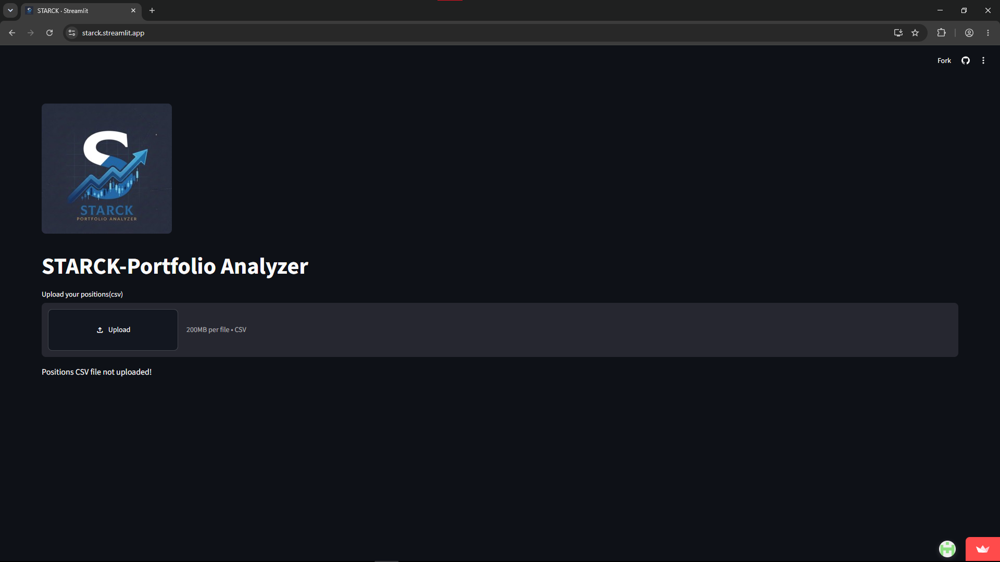
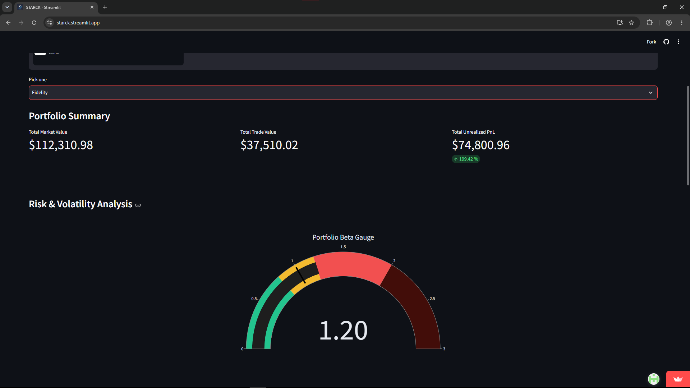
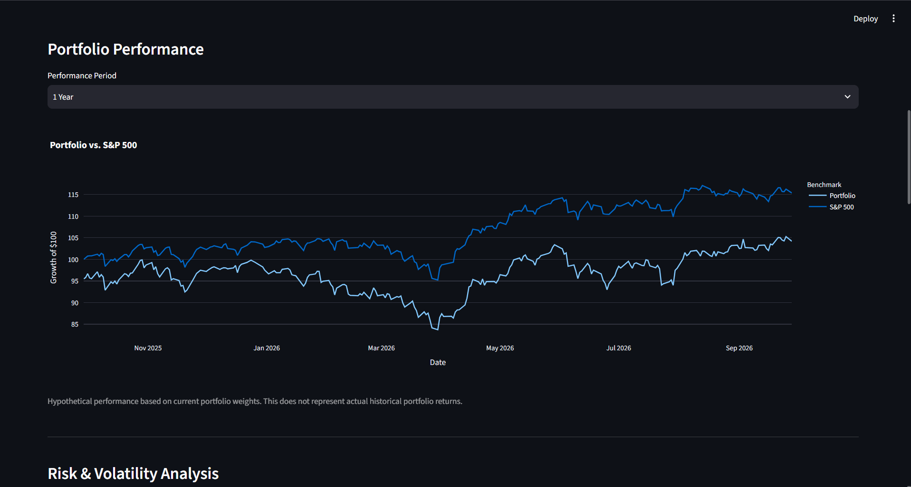
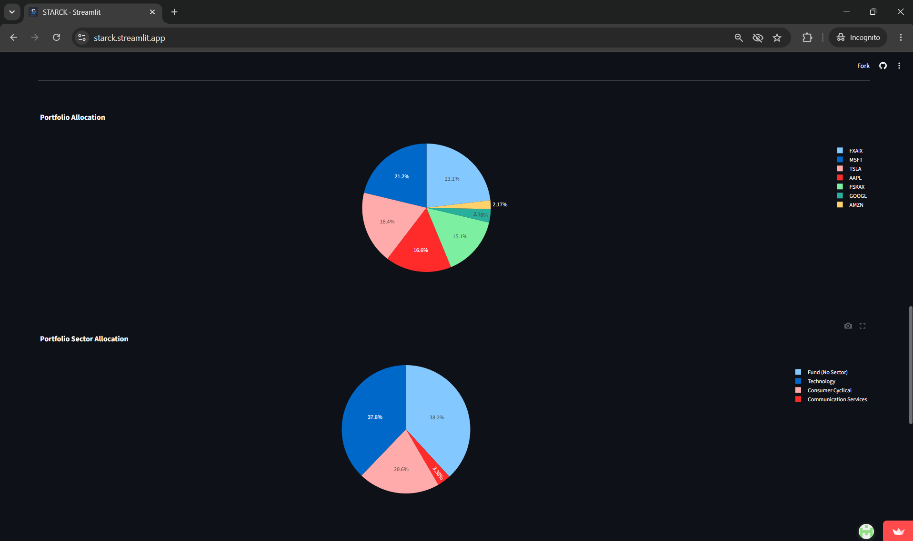
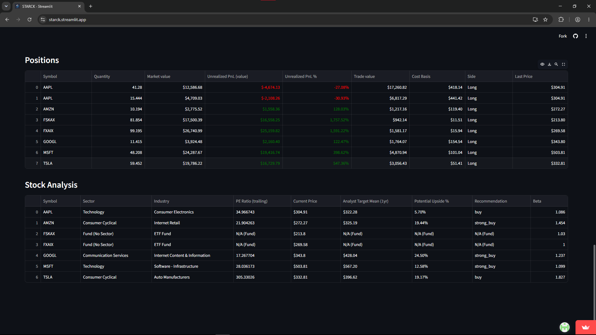

# STARCK

## Portfolio Analytics Dashboard
STARCK is a portfolio analytics dashboard built with Python and Streamlit. 
It allows users to upload supported brokerage CSV files and analyze their portfolio using current market data, portfolio statistics, risk metrics, and visualizations.

## Features

### Portfolio Analytics
- Total market value
- Total trade value
- Unrealized P&L ($)
- Unrealized P&L (%)
- Portfolio beta
- Portfolio allocation
- Sector allocation

### Stock Analytics
- Current market price
- Individual stock beta
- P/E trailing ratio
- Analyst recommendation
- 1-year average price target
- Potential upside (%)

### Performance Analysis
- Historical portfolio performance
- Comparison with the S&P 500
- 1-year, 3-year, and 5-year performance periods
- Growth of $100 performance visualization
- Hypothetical performance based on current portfolio weights

### Visualizations
- Portfolio allocation pie chart
- Sector allocation pie chart
- Portfolio beta gauge
- Gain/loss formatting

### Market Data
STARCK retrieves the latest available market prices using Yahoo Finance when the application is loaded or refreshed. These prices are used to calculate the Unrealized P&L and current market value

## Supported Brokerages

STARCK currently supports: 

- Merrill Lynch
- TradingView (paper trading)
- Fidelity
- Charles Schwab

## Libraries

- Python
- Streamlit
- Pandas
- Plotly
- yfinance

## Project Structure

```text
├── app.py              # Main Streamlit application
├── screenshots/             # Sample Screenshots
│   └── upload_page.png        # Upload page
│   └── top_metrics.png        # Portfolio Metrics page
│   └── performance_chart.png        # Portfolio vs. S&P 500 page
│   └── pie_charts.png        # Pie Charts page
│   └── positions_and_analysis.png        # Positions and analysis page
├── sample_data/             # Sample Data
│   └── fidelity_sample.csv        # Fidelity Sample
├── assets/             # Static visual elements
│   └── starck_logo.png        # Project logo image file
├── charts.py           # Data visualization
├── data_cleaning.py    # Cleaning data frames
├── market_data.py      # API fetching and financial market data
└── portfolio_utils.py  # Brokerage mapping and portfolio formatting
```

## Screenshots

### Upload Page


### Portfolio Metrics Page


### Portfolio vs. S&P 500 Page


### Pie Charts Page


### Positions and Analysis Page


## Demo Data

Here is a fictional Fidelity portfolio csv for users to interact with through STARCK
[Download the sample Fidelity portfolio](sample_data/fidelity_sample.csv)

## How it works

1. Upload a supported brokerage CSV file.
2. STARCK identifies and cleans the raw brokerage data.
3. Brokerage specific column names are mapped to a standardized format.
4. The application retrieves the latest available market data using Yahoo Finance.
5. Current market value and unrealized P&L are calculated using the latest available prices.
6. Current portfolio weights are used to generate a hypothetical historical performance series.
7. The hypothetical portfolio performance is compared with the S&P 500.
8. Portfolio statistics and stock analytics are displayed in the dashboard.
9. Charts provide visualizations of portfolio allocation, sector allocation, portfolio beta, and historical performance.

## Portfolio Beta

STARCK calculates portfolio beta using market value weightings of individual assets.

## Installation

STARCK  is available as a deployed web application, so no installation is required to use it.

To run STARCK locally, clone the repository and install the required dependencies:

```bash
git clone https://github.com/Preston-02/STARCK-PORTFOLIO-ANALYZER.git
cd STARCK
pip install -r requirements.txt
streamlit run app.py 
```

## Data Privacy

STARCK does not require users to provide brokerage login credentials.

Users upload brokerage CSV files directly to the application. Users should avoid uploading files with sensitive information that is not required for portfolio analysis.

## Known Limitations

- Leverage positions may not be calculated correctly into metrics.
- Some securities may not have beta which can skew portfolio beta calculation.
- Market prices are updated when the application is refreshed or loaded.
- Works with portfolios specifically with stocks and funds

## Future Improvements

- Additional brokerage support
- Improved ETF sector classification
- Monte Carlo portfolio simulation
- Additional risk metrics

## Author

Preston Jones

STARCK was created as a personal project combining financial analysis, Python programming, data processing, market data, and data visualizations.


